<div align="center">

# Sales Analysis 2025

**MONTHLY CHALLENGE (WYZWANIE MIESIĄCA)**

From a CSV file to a dashboard: data quality control in SQL Server and sales analysis in Excel

 

</div>

---

## Table of contents

- [Introduction](#introduction)
  - [Goal](#goal)
  - [Source data](#source-data)
  - [Glossary of Polish names](#glossary)
  - [Project stages](#project-stages)
  - [Why data quality control in SQL and not in Excel](#why-sql)
- **[Part I – Data quality in SQL Server](#part-1)**
  - [1. Goal and scope of Part I](#s1)
  - [2. Importing data into SQL Server](#s2)
  - [3. Initial data overview](#s3)
  - [4. Data quality check plan for each column](#s4)
  - [5. Check results](#s5)
  - [6. Summary of Part I](#s6)
- **[Part II – Sales analysis in Excel](#part-2)**
  - [7. Data preparation in Power Query](#s7)
  - [8. Analytical questions and approach](#s8)
  - [9. Analysis results](#s9)
  - [10. Additional analyses](#s10)
  - [11. Dashboard](#s11)
  - [12. Analysis summary](#s12)
  - [13. Business recommendations](#s13)
  - [14. Further analysis and data recommendations](#s14)

---

<a id="introduction"></a>
## Introduction

<a id="goal"></a>
### Goal

The goal of this project is to analyse the 2025 sales data of an online shop, including a data quality check, data preparation, analysis and visualisation of the results. I want to answer which product categories and sales channels bring the most revenue, how sales change throughout the year and what drives their growth. At the end I present conclusions and recommendations for the company.

<a id="source-data"></a>
### Source data

The source data is a CSV file containing 14,174 orders placed between 1 January and 31 December 2025. Each order is described by five columns:

- **numer_zamowienia** (order number) – order identifier, e.g. ZAM-2025-008688,
- **data** (date) – the date the order was placed,
- **kategoria** (category) – product category (6 categories),
- **kanal_sprzedazy** (sales channel) – the channel through which the order came in: Sklep internetowy (Online store), Marketplace, Facebook Ads or Google Ads,
- **kwota_zl** (amount in PLN) – order value in Polish zloty.

Columns in the file are separated by a semicolon and amounts use a dot as the decimal separator, which mattered during the data import.

<a id="glossary"></a>
### Glossary of Polish names

The data, screenshots and charts are in Polish. Throughout the text I use the English names below; the Polish name is given in brackets on first use in each section and in chart titles, so that the text can be matched with the screenshots.

| Polish (in data and screenshots) | English (in text) |
|---|---|
| Elektronika | Electronics |
| Dom i ogród | Home & Garden |
| Odzież | Clothing |
| Sport | Sports |
| Uroda | Beauty |
| Zabawki i prezenty | Toys & Gifts |
| Sklep internetowy | Online store |
| Marketplace, Facebook Ads, Google Ads | (unchanged) |

<a id="project-stages"></a>
### Project stages

1. Importing the CSV file into SQL Server and choosing data types.
2. Data quality control in SQL: null values, duplicates, date validity, naming consistency and amount validity.
3. Data preparation in Excel using Power Query.
4. Analysis in pivot tables and answers to six business questions.
5. Additional analyses based on my own observations.
6. Charts and a dashboard summarising the results.
7. Conclusions, limitations of the analysis and recommendations.

<a id="why-sql"></a>
### Why data quality control in SQL and not in Excel

I decided to check, and if necessary clean, the data in SQL Server rather than directly in Excel, for several reasons:

- Every step is saved as a query. I can reproduce it at any time, show it to another person or run it again on a new version of the data.
- I work on a table in a database and the original CSV file stays untouched. In Excel it is easy to accidentally overwrite or delete cells.
- Checking e.g. duplicates or null values is a single query in SQL, instead of manually browsing thousands of rows.
- SQL is a core tool for a data analyst, and this project let me practise it on a real dataset.

I used Excel, with Power Query and pivot tables, in the second part for the analysis and visualisation of the results, because it allows building summaries and charts quickly.

<p align="right"><a href="#table-of-contents">↑ Back to table of contents</a></p>

---

<a id="part-1"></a>
<div align="center">

# PART I – Data quality in SQL Server

</div>

<a id="s1"></a>
## 1. Goal and scope of Part I

In this part I import the CSV file into SQL Server, choose the column types and check the data quality before moving on to the actual analysis.

<p align="right"><a href="#table-of-contents">↑ Back to table of contents</a></p>

---

<a id="s2"></a>
## 2. Importing data into SQL Server

### 2.1 Table structure and column types

I imported the data using the Import Flat File wizard in SSMS. The wizard detected 5 columns and suggested the following data types:

<p align="center">
  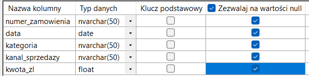<br>
  <em><b>Screenshot 1.</b> Column types suggested by the import wizard</em>
</p>

Most of the types were correct. The only change I planned was changing the type of the kwota_zl column from FLOAT to DECIMAL(18,2).

| Column | Type from wizard | Target type | Notes |
|---|---|---|---|
| numer_zamowienia | nvarchar(50) | nvarchar(50) | Text identifier |
| data | date | date | Date type, no change |
| kategoria | nvarchar(50) | nvarchar(50) | Text values |
| kanal_sprzedazy | nvarchar(50) | nvarchar(50) | Text values |
| kwota_zl | float | decimal(18,2) | Monetary values |

**Why did I change the type from FLOAT to DECIMAL?** FLOAT stores numbers approximately, so rounding errors can accumulate when summing many amounts. DECIMAL stores values exactly, which gives correct totals to the grosz and a uniform format of amounts.

<p align="center">
  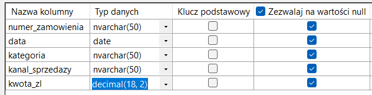<br>
  <em><b>Screenshot 2.</b> Column settings before import: kwota_zl as decimal(18,2), NULL values allowed</em>
</p>

**I allowed NULL values in all columns.** I wanted the whole table to load in its raw state, without rejecting any rows. I check for NULL values only in the next step, as part of the quality control. For the same reason I did not set a primary key: possible duplicates could block the import.

### 2.2 Problem with importing the kwota_zl column

When I tried to import the data, a conversion error appeared:

<p align="center">
  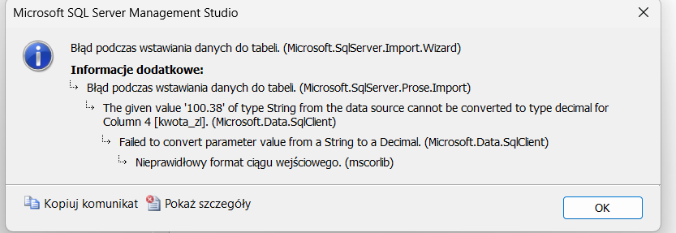<br>
  <em><b>Screenshot 3.</b> Error converting the value "100.38" to the decimal type</em>
</p>

In the source file amounts are written with a dot as the decimal separator (e.g. 100.38), while the Polish regional settings of the system expect a comma. The same error occurred when I tried to import the column as FLOAT, because every numeric type is read according to the regional settings.

To load all the data correctly, I imported the kwota_zl column as text (NVARCHAR). I did the conversion to DECIMAL(18,2) in SQL Server after the import, as part of data cleaning (section 5.6).

After this change the import completed successfully:

<p align="center">
  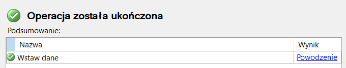<br>
  <em><b>Screenshot 4.</b> Confirmation of a successful data import</em>
</p>

<p align="right"><a href="#table-of-contents">↑ Back to table of contents</a></p>

---

<a id="s3"></a>
## 3. Initial data overview

First, I looked at the table structure and what the data looks like:

```sql
SELECT *
FROM dbo.SALE;
```

<p align="center">
  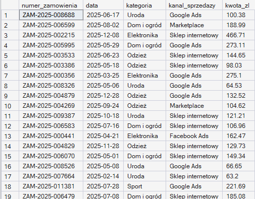<br>
  <em><b>Screenshot 5.</b> Data preview in the dbo.SALE table</em>
</p>

Then I checked the number of rows:

```sql
SELECT count (*)
FROM dbo.SALE;
```

<p align="center">
  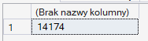<br>
  <em><b>Screenshot 6.</b> Number of rows in the table</em>
</p>

The table contains 14,174 rows. At first glance the data looks very good and it seems it will not need much cleaning. To be sure, however, I ran a series of control tests.

<p align="right"><a href="#table-of-contents">↑ Back to table of contents</a></p>

---

<a id="s4"></a>
## 4. Data quality check plan for each column

Before writing the queries, I decided what I would check in each column and why:

- **All columns: NULL values.** Empty cells mean missing information. An order without a date, category or amount would not be included in some of the summaries, and totals and averages would be understated. A large number of missing values could also indicate a problem with data collection.
- **numer_zamowienia: duplicates.** Each order should have a unique number. A duplicate could indicate an error during data collection or export, e.g. the same order being saved twice. It would then inflate the number of orders and the sales value, and thus distort the business analysis.
- **data: format and range.** Dates written in different formats may be read incorrectly, e.g. 03.04 as 4 March instead of 3 April. Dates outside 2025, from the future or very old, would indicate errors in the data and distort the analysis of sales over time.
- **kategoria: naming consistency.** The same category written in several ways, e.g. "Elektronika" and "elektronika", would be split into separate items in pivot tables, and the results would be wrong.
- **kanal_sprzedazy: naming consistency.** For the same reason I check that no channel appears in several variants, e.g. "FB Ads" and "Facebook Ads".
- **kwota_zl: zero and negative values.** Each order should have a positive value. An amount equal to zero or negative could mean a return, a test order or a recording error, and would understate totals and averages.

<p align="right"><a href="#table-of-contents">↑ Back to table of contents</a></p>

---

<a id="s5"></a>
## 5. Check results

### 5.1 NULL values

First, I checked whether NULL values occur in any column. I did this with the following query:

```sql
SELECT count (*) total_rows,
SUM(CASE WHEN numer_zamowienia IS NULL THEN 1 ELSE 0 END) AS null_numer_zamowienia_rows,
SUM(CASE WHEN data IS NULL THEN 1 ELSE 0 END) AS null_data,
SUM(CASE WHEN kategoria IS NULL THEN 1 ELSE 0 END) AS null_kategoria,
SUM(CASE WHEN kanal_sprzedazy IS NULL THEN 1 ELSE 0 END) AS null_kanal_sprzedazy,
SUM(CASE WHEN kwota_zl IS null THEN 1 ELSE 0 END) AS null_kwota_zl
FROM dbo.SALE;
```

With this query I get the number of all rows in the first column, and the other sums with the CASE expression show me how many nulls there are in each column. This solution shows me the result for all columns at once, in one row, without writing a separate query for each column. The results are also easy to compare with the total number of rows.

<p align="center">
  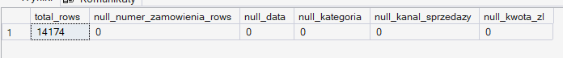<br>
  <em><b>Screenshot 7.</b> Number of NULL values in each column</em>
</p>

> As the screenshot above shows, there are no NULL values in any column, so I could move on to the next stage of checking the data.

### 5.2 Uniqueness of order numbers

Next, I checked whether each order has a unique number. I did this with the following query:

```sql
SELECT count(*) AS total_rows, count(DISTINCT numer_zamowienia) AS unique_numer_aamowienia
FROM dbo.SALE;
```

The query compares two numbers: COUNT(*) counts all rows, and COUNT(DISTINCT numer_zamowienia) counts only the different order numbers, i.e. it counts each number once.

<p align="center">
  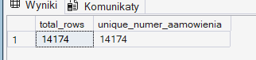<br>
  <em><b>Screenshot 8.</b> Comparison of the number of rows with the number of unique order numbers</em>
</p>

> The query result shows that the number of unique order numbers (14,174) is equal to the number of all rows, so there are no duplicate orders in the data.

### 5.3 Date validity

In the next step I checked whether any unusual date formats were hidden in the data column:

```sql
SELECT data
FROM dbo.SALE
WHERE data LIKE '__-__-____'
OR data LIKE '__/__/____'
OR data LIKE '__.__.____'
OR data LIKE '____.__.__'
OR data LIKE '____/__/__';
```

At first glance all dates had the same format (year-month-day), but I decided to check whether other formats, not visible in the preview, also occur in the dataset. The query looks for dates matching other popular formats, e.g. DD-MM-YYYY, DD/MM/YYYY, DD.MM.YYYY, YYYY.MM.DD and YYYY/MM/DD.

<p align="center">
  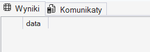<br>
  <em><b>Screenshot 9.</b> Result of the search for unusual date formats</em>
</p>

As screenshot 9 shows, the query returned no rows, which means there are no unusual date formats in the column.

Then I checked the date range. I wanted to make sure that there are no invalid dates in the dataset, e.g. from 2022, because the data should contain information from 2025 only:

```sql
SELECT MAX(data) AS latest_date, MIN(data) AS earliest_date
FROM dbo.SALE;
```

The MAX and MIN functions return the latest and the earliest date in the column. These two values are enough to check whether all dates fall within the expected range.

<p align="center">
  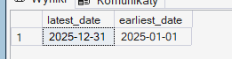<br>
  <em><b>Screenshot 10.</b> Date range in the table</em>
</p>

> As screenshot 10 shows, the date range starts on 1 January 2025 (2025-01-01) and ends on 31 December 2025 (2025-12-31). So there are no dates outside 2025 in the data.

### 5.4 Product categories

In the next stage I checked the product categories, in particular whether their names are uniform and consistent. I did this with the following query:

```sql
SELECT DISTINCT kategoria
FROM dbo.SALE;
```

SELECT DISTINCT returns a list of unique values from a column, i.e. each category only once. In such a short list it is easy to spot typos, differences in letter case or several spellings of the same name.

<p align="center">
  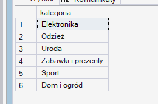<br>
  <em><b>Screenshot 11.</b> Unique values in the kategoria column</em>
</p>

> There are 6 clearly named categories in the dataset: Electronics (Elektronika), Clothing (Odzież), Beauty (Uroda), Toys & Gifts (Zabawki i prezenty), Sports (Sport) and Home & Garden (Dom i ogród). None of them appears in several spellings.

### 5.5 Sales channels

In the same way I checked the names of the sales channels:

```sql
SELECT DISTINCT kanal_sprzedazy
FROM dbo.SALE;
```

<p align="center">
  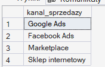<br>
  <em><b>Screenshot 12.</b> Unique values in the kanal_sprzedazy column</em>
</p>

> In this case there are 4 sales channels: Google Ads, Facebook Ads, Marketplace and Online store (Sklep internetowy). They are named clearly and unambiguously, and none of them appears in several variants (there are not, for example, both "FB Ads" and "Facebook Ads").

### 5.6 Order amounts

Finally, I moved on to the column with order amounts. As planned in section 2.2, I changed the type of the kwota_zl column from nvarchar(50) to decimal(18,2) with the following query:

```sql
ALTER TABLE dbo.SALE
ALTER COLUMN kwota_zl decimal(18,2)
```

The conversion completed correctly for all rows. Unlike the import wizard, SQL Server recognises the dot as the decimal separator when converting text to a number, regardless of the system's regional settings.

Then I checked whether there are amounts equal to zero or negative.

```sql
SELECT *
FROM dbo.SALE
WHERE kwota_zl <= 0;
```

<p align="center">
  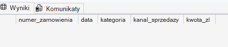<br>
  <em><b>Screenshot 13.</b> Search for orders with an amount less than or equal to 0</em>
</p>

> As screenshot 13 shows, there are no zero or negative amounts in the kwota_zl column that could indicate errors in the data.

<p align="right"><a href="#table-of-contents">↑ Back to table of contents</a></p>

---

<a id="s6"></a>
## 6. Summary of Part I

The dbo.SALE table has very good data quality. All tests passed, and the only change needed was correcting the data type of the kwota_zl column.

| Check area | Result | Status |
|---|---|---|
| NULL values | None in all 5 columns | **✔ Correct** |
| Duplicate orders | 14,174 rows = 14,174 unique numbers | **✔ Correct** |
| Date format | Uniform (DATE type) | **✔ Correct** |
| Date range | 2025-01-01 – 2025-12-31 | **✔ Correct** |
| Categories | 6 consistent values | **✔ Correct** |
| Sales channels | 4 consistent values | **✔ Correct** |
| Amounts | No values ≤ 0 | **✔ Correct** |
| kwota_zl column type | Changed from nvarchar(50) to decimal(18,2) | **✔ Corrected** |

### Key conclusions

- **The data is complete and consistent.** There are no NULL values, no duplicate order numbers and no inconsistencies in the naming of categories and sales channels.
- **The time range meets expectations.** The data covers the full year 2025, from 1 January to 31 December, with no future dates and no historical dates outside the range.
- **The only technical problem was the decimal separator.** The difference between the way amounts are written in the file (dot) and the Polish regional settings (comma) made it impossible to import the amounts directly as numbers. I solved the problem by importing the column as text and converting it in SQL Server.
- **The data types are ready for analysis.** The kwota_zl column has the DECIMAL(18,2) type, which guarantees exact totals and averages to the grosz, and the data column has the DATE type, which allows grouping by months and quarters.
- **No data cleaning was needed.** Apart from changing the column type, the data did not require any corrections.

### Next steps

Having confirmed the data quality, I move on to the actual sales analysis. I will do it in Excel, using Power Query, pivot tables and charts.

<p align="right"><a href="#table-of-contents">↑ Back to table of contents</a></p>

---

<a id="part-2"></a>
<div align="center">

# PART II – Sales analysis in Excel

</div>

In this part I describe step by step how I prepared the data in Power Query, which pivot tables and charts I built and what conclusions they lead to.

<a id="s7"></a>
## 7. Data preparation in Power Query

I loaded the CSV file into Excel through Power Query (Data → Get Data → From File → From Text/CSV, in Polish: Dane → Pobierz dane → Z pliku → Z pliku tekstowego/CSV), and not by simply opening the file. I chose this for two reasons:

- **Repeatability.** Power Query saves every action as a separate step. When I get a new version of the file, it is enough to click "Refresh" ("Odśwież") and all transformations run by themselves.
- **Control over data types.** When a file is simply opened, Excel guesses the types itself and may silently turn some amounts into text or dates. In Power Query I set the type of each column deliberately.

### 7.1 Loading the file, column names and amount type

The file loaded without column names, and the columns are separated by a semicolon. After loading, they had technical names (Column1, Column2, etc.), so I gave them readable names, consistent with the names in the SQL Server table: numer_zamówienia, data, Kategoria, kanal_sprzedaży and kwota_zł.

<p align="center">
  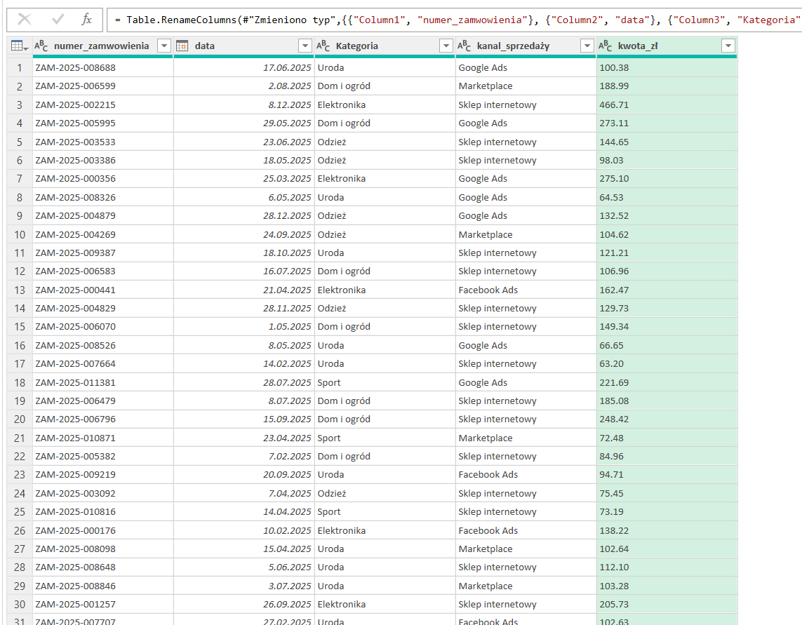<br>
  <em><b>Screenshot 14.</b> Data in the Power Query editor after naming the columns</em>
</p>

The kwota_zł column loaded as text (ABC icon in the header), and the amounts were written with a dot, e.g. 100.38. The change of type to DECIMAL that I made in SQL Server did not matter here, because I loaded the original CSV file into Excel, not the table from the database. So I decided to change the column type to numeric.

The same problem appeared here as during the import into SQL Server: the decimal separator in the file is a dot, while the Polish version of Excel expects a comma. In the US version of Excel the value 100.38 would immediately be read as a number. In the Polish version Excel has to be told in what format the numbers in the file are written.

I used the "Change Type → Using Locale" option ("Zmień typ → Przy użyciu ustawień regionalnych") and selected the type "Decimal Number" ("Liczba dziesiętna") and the locale "English (United States)" ("Angielski (Stany Zjednoczone)"):

<p align="center">
  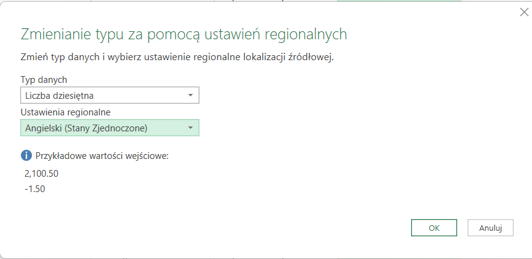<br>
  <em><b>Screenshot 15.</b> Changing the type of the kwota_zł column using the locale</em>
</p>

I chose this step because replacing the characters would require two steps (replacing the values and then changing the type) and would interfere with the data itself. The locale settings solve this in one step. The values stay untouched, and Excel gets the information on how to read them. After this change the amounts are displayed in Polish format, e.g. 100,38.

### 7.2 Row count check

After changing the type, I checked whether all orders made it into Excel. I used the Transform → Count Rows function (Przekształć → Zlicz wiersze):

<p align="center">
  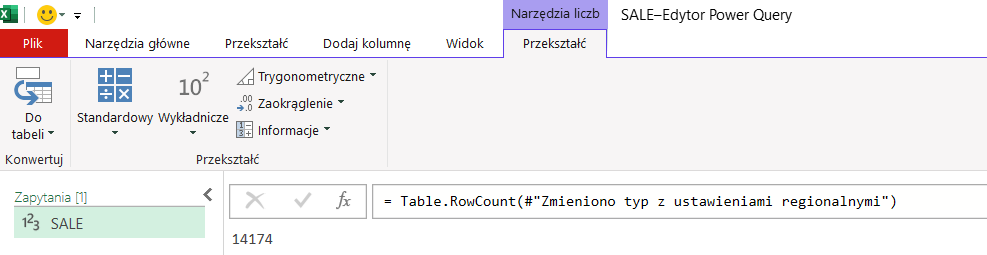<br>
  <em><b>Screenshot 16.</b> Number of rows in Power Query</em>
</p>

> There are 14,174 rows in Power Query, exactly as many as in the dbo.SALE table in SQL Server. No row was lost, and the first row of the file was not mistakenly treated as a header.

The "Counted Rows" ("Zliczone wiersze") step was only a check, so after checking I removed it from the list of applied steps. If it had stayed, a single number would have been loaded into Excel instead of the whole table.

### 7.3 Additional columns: quarter and month

Based on the data column, I added three new columns (Add Column tab → Date, in Polish: Dodaj kolumnę → Data): Kwartał (Quarter), Nazwa miesiąca (Month Name) and Miesiąc (Month). Each of them has a different purpose:

- **Kwartał** (Quarter, values 1–4) allows grouping sales into larger periods and comparing e.g. the end of the year with its beginning.
- **Nazwa miesiąca** (Month Name: styczeń, luty… = January, February…) serves as a readable label in tables and charts.
- **Miesiąc** (Month, number 1–12) is needed for sorting. Excel sorts text alphabetically, so it would order the names alone as: czerwiec, grudzień, kwiecień, lipiec (June, December, April, July). The number allows ordering the months by calendar.

<p align="center">
  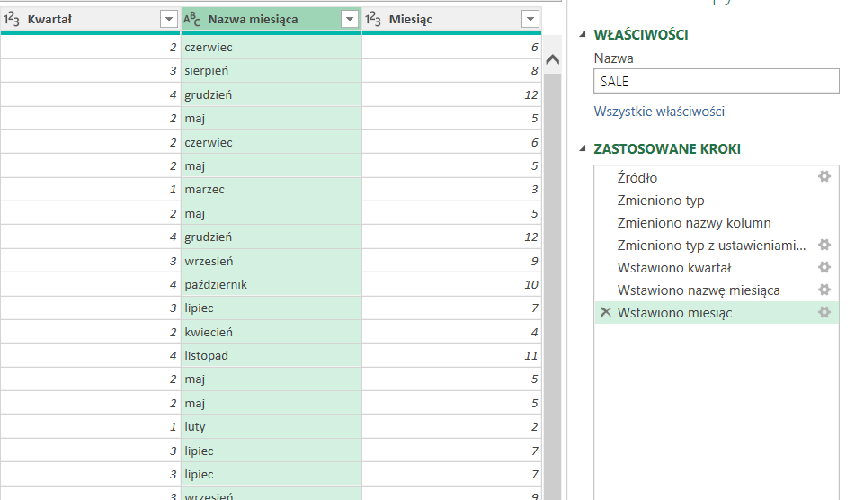<br>
  <em><b>Screenshot 17.</b> New columns and the list of applied steps in Power Query</em>
</p>

I added the columns in Power Query because this way they are ready-made fields in every pivot table and don't have to be created separately in each sheet. I left the original data column unchanged. The data was also deliberately not grouped. All individual orders went to Excel so that pivot tables could summarise them in different ways.

The list of applied steps on the right side of screenshot 17 documents the entire data preparation: source, type change, renaming of columns, type change with locale settings and the three inserted columns.

### 7.4 Loading data into the SALE sheet

I loaded the finished data into Excel (Close & Load / Zamknij i załaduj). It went to a sheet that I named SALE. The table has 8 columns and 14,174 rows and is the only data source for all pivot tables in the workbook.

<p align="center">
  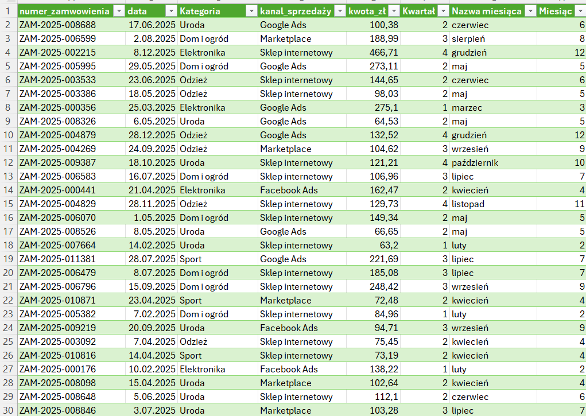<br>
  <em><b>Screenshot 18.</b> Data table in the SALE sheet</em>
</p>

<p align="right"><a href="#table-of-contents">↑ Back to table of contents</a></p>

---

<a id="s8"></a>
## 8. Analytical questions and approach

Based on the SALE table I wanted to answer six questions:

1. Which category sells best in the whole of 2025 in terms of sales value and in terms of the number of orders (not necessarily the same category)?
2. How did sales change over time in a selected category (or in all of them at once)?
3. What is the share of each sales channel in the total sales of the year?
4. Which category has the highest and which the lowest average order value?
5. In which month is there a clear "jump" in sales in a given category, and how does it compare with the rest of the year?
6. Does the structure of sales channels differ between categories?

For each question I built a pivot table and a chart. I followed three working rules:

- **One question, one sheet.** Each pivot table with its chart is on a separate sheet. Pivot tables change size with every layout change and cannot overlap, so separate sheets eliminate the risk of errors. In addition, the sheet name immediately tells which question it answers.
- **One data source.** All pivot tables use the SALE table. After the data is refreshed, they all update at the same time.
- **A shared dashboard at the end.** I collected the charts from the individual sheets on one sheet, so that the reader can see all the answers in one place.

Where a table contained two measures (e.g. amounts and percentages) and the chart was supposed to show only one, I created a second, helper pivot table on the same sheet. A pivot chart always plots everything that is in the table, so a helper table allows a readable chart without spoiling the main table and without adding more sheets.

<p align="right"><a href="#table-of-contents">↑ Back to table of contents</a></p>

---

<a id="s9"></a>
## 9. Analysis results

### 9.1 Sales value by category

**Question:** *which category sells best in terms of sales value?*

In the pivot table I placed the Kategoria field in the Rows area (Wiersze) and the kwota_zł field in the Values area (Wartości), summarised by "Sum" ("Suma"). I renamed the field to "Total sales (PLN)" ("Suma sprzedaży (PLN)"), so that the header is understandable without knowing the column names. I sorted the table in descending order by the sum and set the number format with a thousands separator.

<p align="center">
  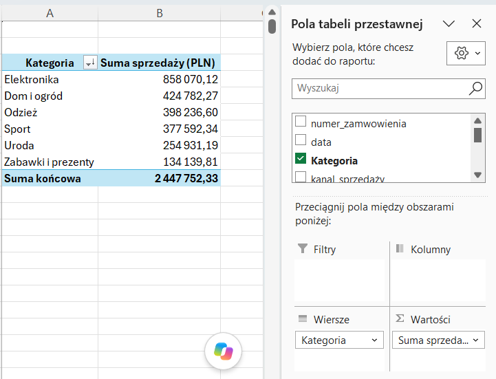<br>
  <em><b>Screenshot 19.</b> Pivot table: sales value by category</em>
</p>

For this table I chose a horizontal bar chart, because I compare one measure across several categories, and the length of the bars lets you assess the differences straight away. The categories are sorted from the smallest to the largest.

<p align="center">
  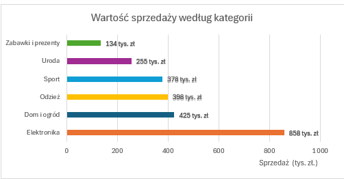<br>
  <em><b>Screenshot 20.</b> Chart: Sales value by category (2025) („Wartość sprzedaży według kategorii”)</em>
</p>

As the chart shows, the company earns by far the most on Electronics (Elektronika): PLN 858,070, i.e. about 35% of the total sales of the year (PLN 2,447,752). That is more than twice as much as the second category, Home & Garden (Dom i ogród, PLN 424,782). The next three categories are close to each other: Home & Garden, Clothing (Odzież, PLN 398,237) and Sports (Sport, PLN 377,592) each have 15–17% of sales. The company earns the least on the Toys & Gifts category (Zabawki i prezenty): PLN 134,140, i.e. about 5.5% of sales. The difference between the best and the weakest category is more than sixfold.

Such a large lead of Electronics may result from two things: customers order it more often than other categories, or a single order in it is much more expensive. To settle this, in the next steps I checked the number of orders (section 9.2) and the average order value (section 9.3).

### 9.2 Number of orders by category

**Question:** *which category sells best in terms of the number of orders?*

I built the table for this question in the same way as the previous one, with one difference: instead of summing the amounts, I count the orders. In the Values area I placed the numer_zamówienia field summarised by "Count" ("Liczba"). I could do this because in Part I I confirmed that order numbers are unique, i.e. one row is one order. Again, I sorted the table in descending order.

<p align="center">
  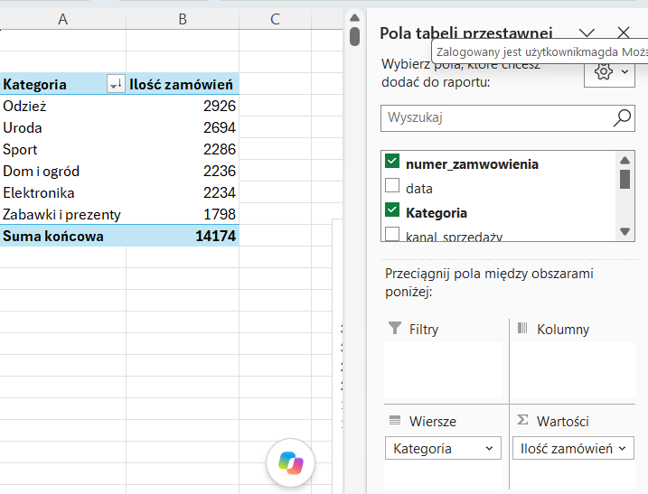<br>
  <em><b>Screenshot 21.</b> Pivot table: number of orders by category</em>
</p>

As the screenshot above shows, the grand total is 14,174, which equals the number of rows in the data. No order was left out.

In this case I again chose a horizontal bar chart, sorted in ascending order. Using the same chart type as in section 9.1 makes it easier to compare both rankings: you can immediately see that the order of the categories is different.

<p align="center">
  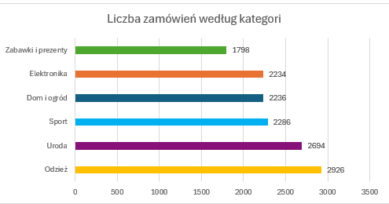<br>
  <em><b>Screenshot 22.</b> Chart: Number of orders by category (2025) („Liczba zamówień według kategorii”)</em>
</p>

As the chart shows (screenshot 22), the most frequently ordered category is Clothing (Odzież, 2,926 orders), closely followed by Beauty (Uroda, 2,694). Electronics (Elektronika), which earns the most, is only in the second-to-last, fifth place with 2,234 orders. Toys & Gifts (Zabawki i prezenty) have the fewest orders (1,798).

My suspicion was confirmed: the lead of Electronics does not come from the number of orders. Clothing has 692 more orders (about 31%), and yet its sales are more than twice as low. You can also see that the number of orders differs between categories much less than the sales value. Between the first and the last category, the difference in the number of orders is about 1.6-fold, while in sales value it is more than sixfold.

Beauty is an interesting case: it is second in terms of the number of orders, but only fifth in terms of sales value. This means that customers buy in this category often, but for small amounts. This may indicate that these are mainly cheaper everyday products, which I check in the next section by analysing the average order value. Toys & Gifts, on the other hand, are last in both rankings, which explains their lowest revenue.

### 9.3 Average order value by category

**Question:** *which category has the highest and which the lowest average order value?*

In the next sheet I again placed Kategoria in Rows and kwota_zł in Values, but in the value field settings I changed the summary from "Sum" ("Suma") to "Average" ("Średnia"). I named the field "Average sales (PLN)" ("Średnia ze sprzedaży (PLN)") and set the format to two decimal places.

<p align="center">
  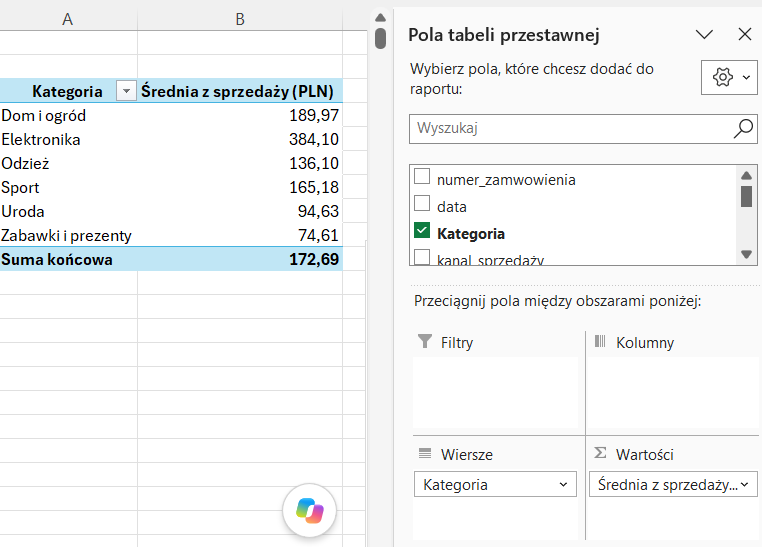<br>
  <em><b>Screenshot 23.</b> Pivot table: average order value (alphabetical order)</em>
</p>

I verified the result manually to make sure the table calculates exactly what I need. For the Home & Garden category (Dom i ogród): PLN 424,782.27 ÷ 2,236 orders = PLN 189.97, which is the same as the table shows. The pivot table goes back to the source data: for each category it sums the amounts of all its orders and divides them by their number. The value in the "Grand Total" row ("Suma końcowa") is calculated in the same way: PLN 172.69 is the average of all 14,174 orders, not the average of the six averages.

Before creating the chart, I also sorted the table from the highest to the lowest average, so that the chart would be clearer and consistent with the two previous ones:

<p align="center">
  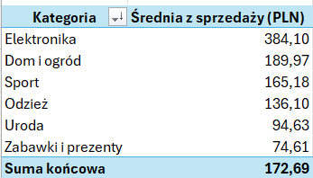<br>
  <em><b>Screenshot 24.</b> Average order value after sorting in descending order</em>
</p>

In this case I also chose a bar chart. I removed the legend from it, because it contained only one item called "Sum" ("Suma"), which would be misleading on a chart of averages. The chart title says what the bars show.

<p align="center">
  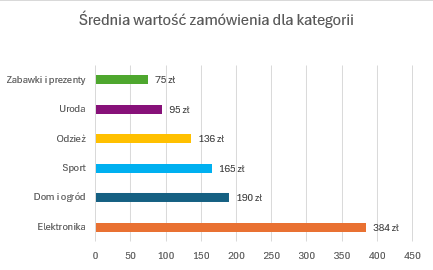<br>
  <em><b>Screenshot 25.</b> Chart: Average order value by category („Średnia wartość zamówienia dla kategorii”)</em>
</p>

Looking at all the tables and charts I have created so far, what I noticed at the beginning is confirmed: Electronics (Elektronika) has by far the highest average order value, PLN 384.10. That is more than twice the average for the whole shop (PLN 172.69), almost three times more than in Clothing (Odzież, PLN 136.10) and more than five times more than in the Toys & Gifts category (Zabawki i prezenty), which has the lowest average (PLN 74.61).

Interesting relationships can also be seen in the other categories:

- **Home & Garden** (Dom i ogród, PLN 189.97) has the second highest average. This explains why the category is second in terms of sales value, even though it is only fourth in terms of the number of orders.
- **Beauty** (Uroda, PLN 94.63) is a category of frequent but cheap purchases. It has the second largest number of orders, but because of its low average its sales are second to last.
- **Clothing** (PLN 136.10) is in the middle of the pack when it comes to the average order value, but it is the clear leader when it comes to the number of orders, and thanks to that it is third in sales.
- **Toys & Gifts** (PLN 74.61) have both the fewest orders and the lowest average, hence the lowest revenue.
- **Only two categories,** Electronics and Home & Garden, have an average higher than the average for the whole shop.

| Category | Sales (PLN) | Share | Number of orders | Average (PLN) |
|---|---:|---:|---:|---:|
| Electronics | 858,070 | 35.1% | 2,234 | 384.10 |
| Home & Garden | 424,782 | 17.4% | 2,236 | 189.97 |
| Clothing | 398,237 | 16.3% | 2,926 | 136.10 |
| Sports | 377,592 | 15.4% | 2,286 | 165.18 |
| Beauty | 254,931 | 10.4% | 2,694 | 94.63 |
| Toys & Gifts | 134,140 | 5.5% | 1,798 | 74.61 |
| **Total** | **2,447,752** | **100%** | **14,174** | **172.69** |

> As the summary shows, Electronics is the best in terms of sales value, and Clothing in terms of the number of orders. The difference is explained by the average order value: the highest in Electronics (PLN 384.10), the lowest in the Toys & Gifts category (PLN 74.61).

The data contains the value of the whole order, not the prices of individual products. So I can say that orders in Electronics are more expensive, but I cannot determine whether this is due to more expensive products or to a larger number of items in one order. To check this, the input data would need an additional column with the number of products ordered. I could then calculate the average price of a single product in each category.

### 9.4 Share of sales channels in the year's sales

**Question:** *what is the share of each sales channel in the total sales of the year?*

To answer this question, I placed the kanal_sprzedaży field in Rows and dragged the kwota_zł field to Values twice. I wanted to see the amount in PLN and its percentage share side by side.

<p align="center">
  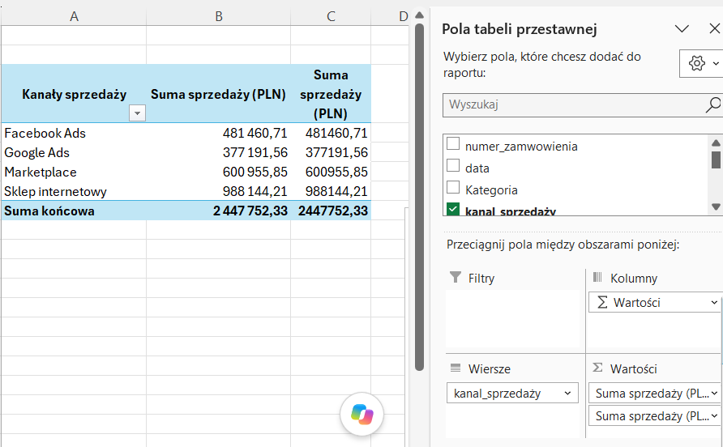<br>
  <em><b>Screenshot 26.</b> The same sales total added to the table twice</em>
</p>

I changed the second field to percentages in the value field settings, on the "Show Values As" tab ("Pokaż wartości jako"). I selected the "% of Column Total" option ("% sumy kolumny") and named the field "% of sales in the year" ("% sprzedaży w roku"):

<p align="center">
  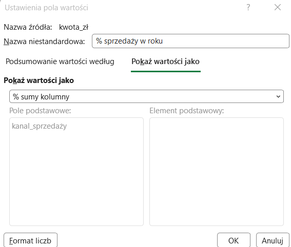<br>
  <em><b>Screenshot 27.</b> Value field settings: showing values as % of Column Total</em>
</p>

I chose this option because when choosing how to calculate percentages, I ask myself: "100% is supposed to be what?". Here 100% is the total sales of the year. There is only one column of numbers in this table, so "% of Column Total" gives the same result as "% of Grand Total" ("% sumy końcowej").

<p align="center">
  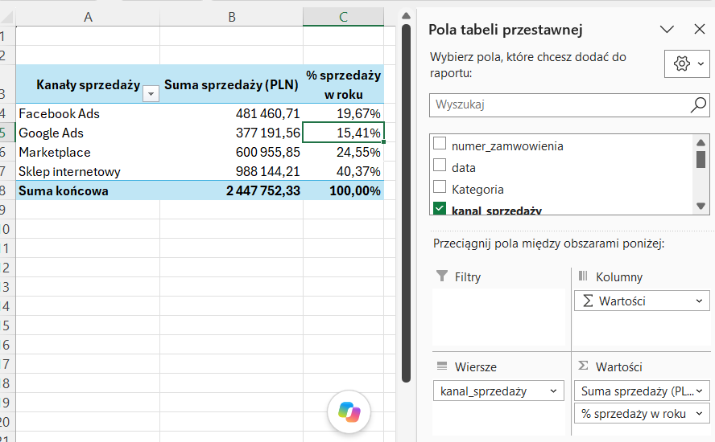<br>
  <em><b>Screenshot 28.</b> Pivot table: sales and share of sales channels</em>
</p>

As shown above, the shares add up to 100%, and the sales total (PLN 2,447,752.33) is the same as in the category table.

For this table I chose a pie chart with percentage labels. The question is about the share of parts in a whole, there are only four channels, and their shares add up to 100%, so a pie chart is readable here.

<p align="center">
  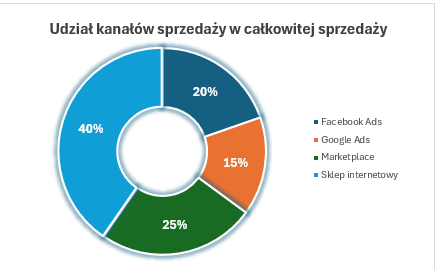<br>
  <em><b>Screenshot 29.</b> Chart: Share of sales channels in total sales (2025) („Udział kanałów sprzedaży w całkowitej sprzedaży”)</em>
</p>

The chart above clearly shows that the most important channel is the online store (Sklep internetowy): PLN 988,144, i.e. 40.37% of sales. Marketplace is second (PLN 600,956, 24.55%), followed by Facebook Ads (PLN 481,461, 19.67%) and Google Ads (PLN 377,192, 15.41%).

According to the dataset description, the kanal_sprzedazy column means the channel through which the order came in. This summary shows that:

- The shop's own online store generates more sales than both advertising channels together (Facebook Ads and Google Ads together account for 35.08%).
- The online store and Marketplace together account for almost two thirds of sales (64.92%).
- Among the advertising channels, Facebook Ads brings about PLN 104k more than Google Ads.

> The stable share of the online store, at around 40%, independent of the category (section 9.7) and of the month (section 10.2), may indicate that the shop has a loyal customer base or a recognisable brand. Confirming this hypothesis would require customer data (e.g. an anonymous identifier) that would make it possible to distinguish returning customers from new ones.

### 9.5 Sales in consecutive months

**Question:** *how did sales change over time?*

To see how sales changed during the year, I created a pivot table with the months in Rows and the sum of kwota_zł in Values. I added a category slicer (fragmentator) to it, thanks to which I can display the same table for the whole shop or only for selected categories. In the screenshot all categories are selected, so the table shows the sales of the whole shop:

<p align="center">
  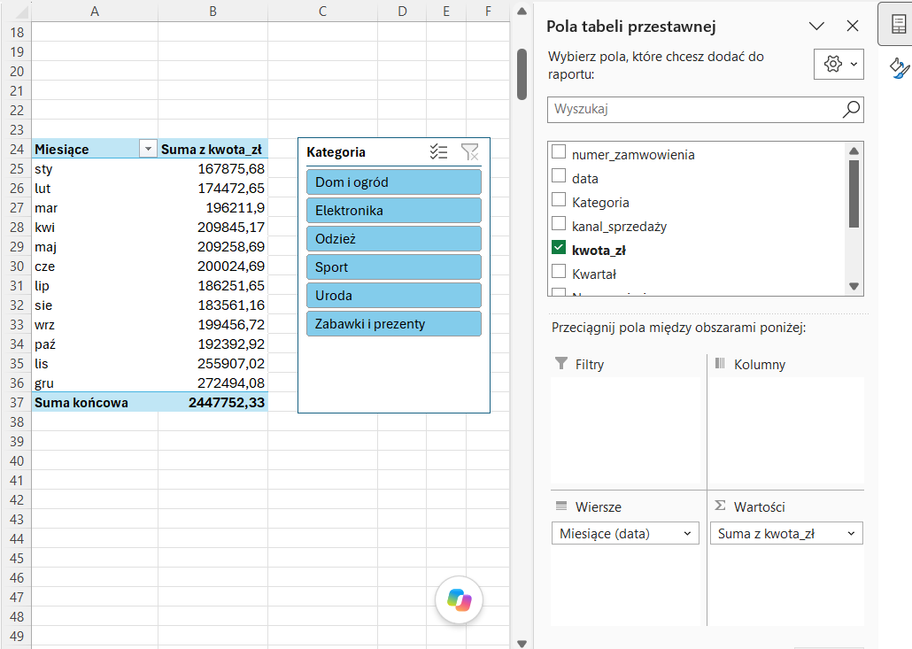<br>
  <em><b>Screenshot 30.</b> Pivot table: sales value in consecutive months, with a category slicer</em>
</p>

The grand total (PLN 2,447,752.33) matches the previous tables, so all orders are included in the summary.

For this table I chose a column chart with the months on the horizontal axis. Columns arranged in calendar order let you see straight away how sales change during the year and which months stand out from the rest.

<p align="center">
  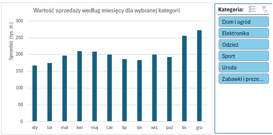<br>
  <em><b>Screenshot 31.</b> Chart: Sales value by month (2025) („Wartość sprzedaży według miesięcy dla wybranych kategorii”)</em>
</p>

For most of the year, monthly sales are in the range of PLN 168–210k. The beginning of the year is the weakest: January (PLN 167,876) and February (PLN 174,473). From March sales grow, and in April and May they reach about PLN 209k. In summer, in July and August, they drop slightly (PLN 183–186k). The last two months clearly stand out: November (PLN 255,907) and December (PLN 272,494), which together account for about 22% of annual sales. December is the best month of the year, and its sales are about 62% higher than in January.

> The shop's sales are fairly stable for most of the year, with a clear increase in November and December.

### 9.6 Seasonality of sales in categories

**Question:** *in which month is there a clear "jump" in sales in a given category, and how does it compare with the rest of the year?*

For this question I created the following table: I placed Kategoria in Rows, the months in Columns (Kolumny), and the kwota_zł field twice in Values, once as the sales total ("Sales (PLN)" / "Sprzedaż (PLN)") and once as a percentage ("%").

<p align="center">
  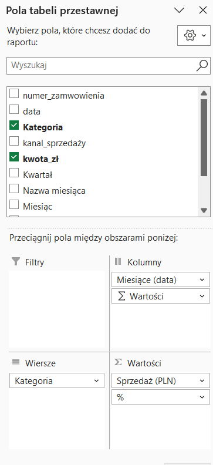<br>
  <em><b>Screenshot 32.</b> Pivot table field layout: categories in rows, months in columns</em>
</p>

I decided to add percentages because the amounts alone are large and at first glance it is hard to see anything in them. In addition, the categories differ greatly in scale: Electronics (Elektronika) sells for PLN 50–130k per month, and Toys & Gifts (Zabawki i prezenty) for PLN 5–40k.

Here I used "% of Row Total" ("% sumy wiersza"), because here 100% is the whole year of one category, and the categories are in the rows. So each cell shows what part of the annual sales of a given category fell in a given month.

I applied conditional formatting (a colour scale) to the columns with percentages. The darker the colour, the larger the month's share in the year, so the jumps can be seen without reading the numbers:

<p align="center">
  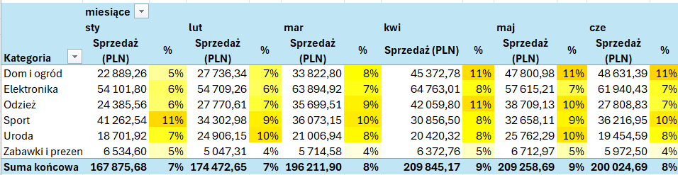<br>
  <em><b>Screenshot 33.</b> Sales and share of the month in the year by category: January–June</em>
</p>

<p align="center">
  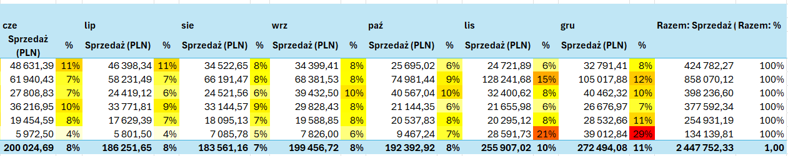<br>
  <em><b>Screenshot 34.</b> Sales and share of the month in the year by category: June–December</em>
</p>

I wanted the chart to be based on the amounts only. That is why I created a second, helper pivot table on the same sheet, in which I left only "Sales (PLN)" and moved the months to the rows, so that they would be on the chart axis:

<p align="center">
  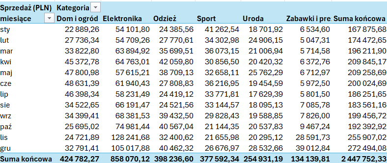<br>
  <em><b>Screenshot 35.</b> Helper table for the chart: monthly sales by category</em>
</p>

Based on it, I created a line chart: months on the horizontal axis, a separate colour for each category. On the chart I set the axis format without decimal places, for the clarity of the chart.

<p align="center">
  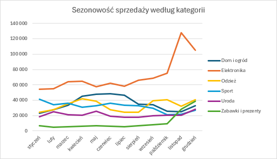<br>
  <em><b>Screenshot 36.</b> Seasonality chart before axis formatting („Sezonowość sprzedaży według kategorii”)</em>
</p>

I decided that the chart would be even clearer if, instead of the value 140 000, the Y axis showed values in the form of 140 with a label saying that these are thousands of zloty. This can be done in the axis options when formatting the chart. I showed this in the screenshot below:

<p align="center">
  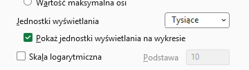<br>
  <em><b>Screenshot 37.</b> Values shown in thousands, without changing the source data</em>
</p>

<p align="center">
  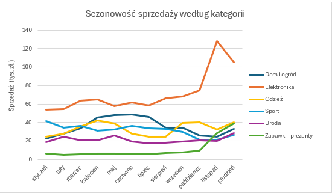<br>
  <em><b>Screenshot 38.</b> Chart: Sales seasonality by category („Sezonowość sprzedaży według kategorii”)</em>
</p>

The seasonality of each category looks as follows:

- **Toys & Gifts.** The category peaks in November and December, with the highest sales in December (29% of annual sales). These two months together account for about half of the category's annual sales, while in the other months the share is 4–7%. This is probably related to the Christmas season. Since demand naturally grows at this time, it is worth considering starting promotional activities before the season (e.g. in October) and preparing stock and logistics for an increased number of orders. It would also be good to consider why this category has no peak at such times of the year as e.g. Children's Day. Here, too, one could expect at least a slight increase in sales. Assessing the profitability of additional campaigns would, however, require data on advertising spending.

- **Electronics.** It also peaks at the end of the year, but interestingly, sales are higher in November (PLN 128k, 15% of annual sales) than in December (PLN 105k, 12%). This seems counter-intuitive, because December is when we buy the most Christmas presents. The reason may be Black Friday, which falls on the last Friday of November (in 2025 it was 28 November). Products in the Electronics category are clearly more expensive than the others (section 9.3), so customers may deliberately wait for this promotion.

  I tested this hypothesis with a pivot table. In Rows I placed the months, and under them the individual days (the Miesiące, Dni and data fields = months, days and date), in Values the number of orders, and in the slicer I selected the Electronics category. So the table shows how many Electronics orders were placed on each day of November:

<p align="center">
  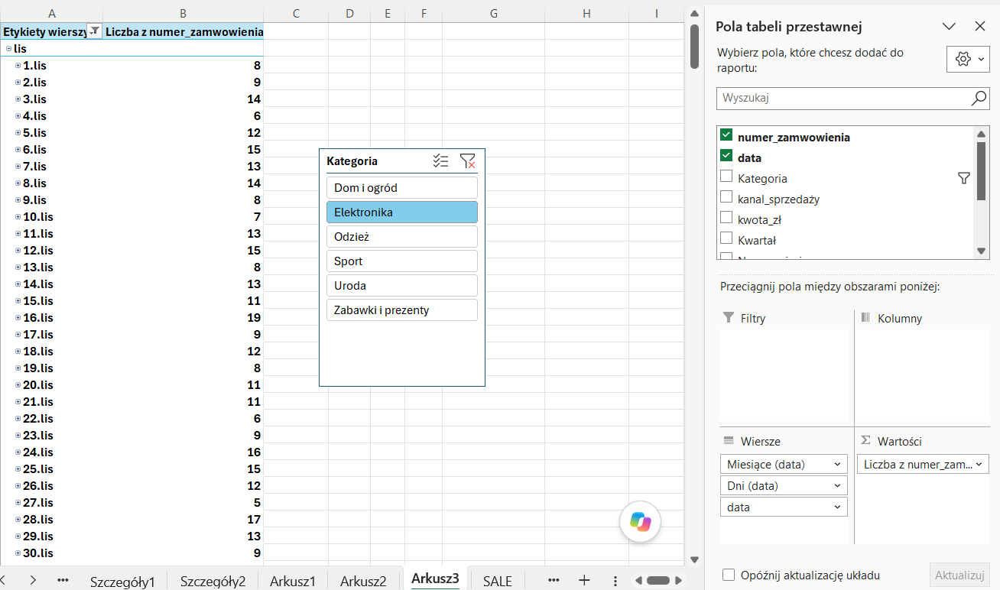<br>
  <em><b>Screenshot 39.</b> Number of Electronics orders on each day of November</em>
</p>

  The results do not confirm that the Black Friday day itself was of great importance. On 28 November indeed clearly more orders were placed (17) than the day before (5), but against the whole month this is not an outlier. A similar number of orders can be seen e.g. on 6 and 12 November (15 each), and on 16 November there were even more (19). My hypothesis in this form was not confirmed.

  In the table we can see that there are more orders throughout November, not just on one day. In November, on average about 11 Electronics orders were placed per day, and in October about 6. This may mean that promotions lasted longer than one day, or that customers spread their Christmas shopping over the whole month. Settling this would require data on promotion dates.

- **Home & Garden.** The highest sales fall in the period from April to July: in each of these months the category reaches about 11% of annual sales (PLN 45–49k), and about 44% in total. This coincides with the season of gardening, planting and spending time outdoors. From August sales fall and are lowest in winter (5% in January). A slight increase can still be seen in December (PLN 33k compared to PLN 25k in November). It may come from buying Christmas decorations or Christmas trees.

- **Sports.** The highest sales fall in January (11% of annual sales), which may be connected with New Year's resolutions. Sales are also higher in March and June (10% each). The June increase may be related to shopping before the summer holidays, when we spend more time outdoors. The weakest period is from October to December (6–7%).

- **Beauty.** Sales are fairly stable (7–8% per month), but there are three clear peaks: February (10%), May (10%) and December (11%). December is most likely related to Christmas. February and May may be related to occasions when cosmetics are often bought as gifts: Valentine's Day (14 February) and Mother's Day (26 May in Poland).

- **Clothing.** It has several smaller peaks instead of one big one: April (11%) and May, September, October and December (10% each). The weakest are January and the summer months: from June to August the share is 6–7%. The spring and autumn peaks may be related to the change of seasons and putting together a wardrobe for the new season, and the December one to Christmas presents. I suggest focusing a bit on this category, because it is very inconspicuous, but I think it has great potential when it comes to sales growth, because it has the largest number of orders and, all in all, a not-bad average order value. I think it would be worth looking into whether it is possible to implement some actions that could raise this average order value. Because raising it by only PLN 14 while keeping the same number of orders already gives us an increase in sales value of about PLN 40k.

The data shows when sales grow, but based on it I cannot say why. That is why I treat all the reasons given above (Christmas, Black Friday, the gardening season, New Year's resolutions, the change of seasons) as hypotheses.

### 9.7 Structure of sales channels in categories

**Question:** *does the structure of sales channels differ between categories?*

I created the table as follows: in Rows I placed the sales channels, in Columns the categories, and in Values the numer_zamówienia field twice, once as the number of orders and once as a percentage.

<p align="center">
  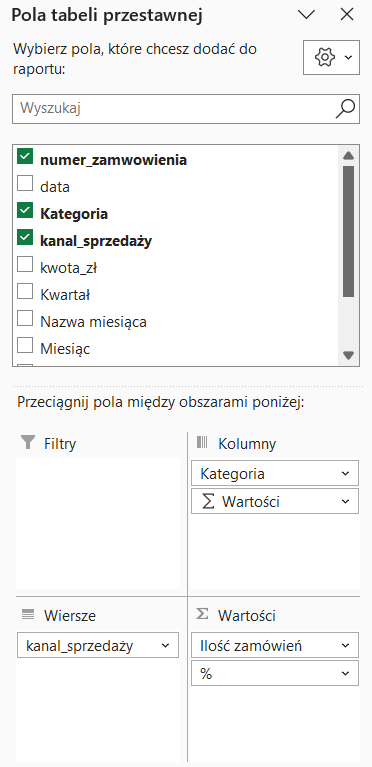<br>
  <em><b>Screenshot 40.</b> Pivot table field layout: channels in rows, categories in columns</em>
</p>

Why the number of orders and not the sales value? In this question I want to check where customers most often buy a given category, which is why I count orders. In section 9.4 I calculated the channel shares by sales value, because that question was about sales.

In this table I used "% of Column Total" ("% sumy kolumny"), because here 100% is all the orders of one category, and the categories are in the columns. Each column adds up to 100% and shows the channel structure within a given category. "% of Grand Total" ("% sumy końcowej") would give a different result in this table: the share of each cell in all orders of the year.

<p align="center">
  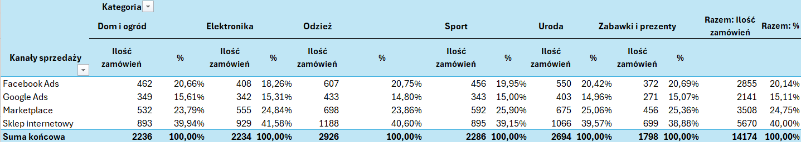<br>
  <em><b>Screenshot 41.</b> Number of orders and share of sales channels in each category</em>
</p>

The chart was supposed to show only the percentage shares, so I created a second, helper table on the same sheet, in which I left only the "%" field:

<p align="center">
  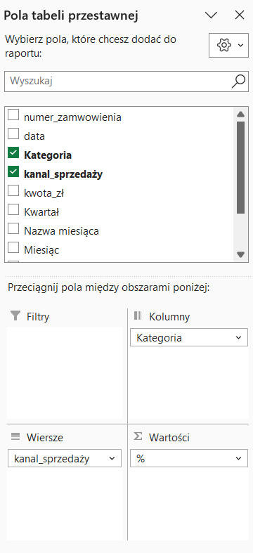<br>
  <em><b>Screenshot 42.</b> Helper table field layout: percentage share only</em>
</p>

<p align="center">
  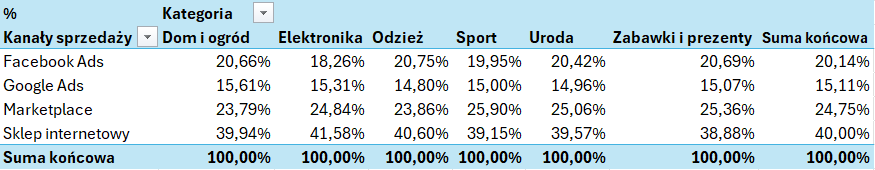<br>
  <em><b>Screenshot 43.</b> Helper table for the chart: share of channels in each category</em>
</p>

I chose a stacked bar chart: channels on the vertical axis, and categories arranged as segments.

<p align="center">
  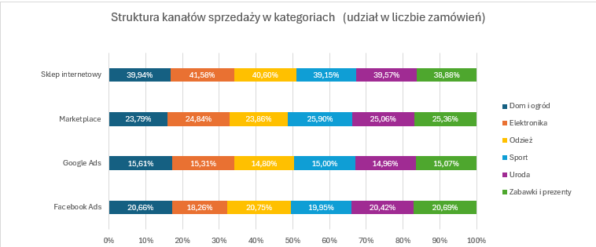<br>
  <em><b>Screenshot 44.</b> Chart: Structure of sales channels in categories („Struktura kanałów sprzedaży w kategoriach (udział w liczbie zamówień)”)</em>
</p>

As the chart above shows, the share of the same channel differs between categories by at most 2–3 percentage points. In each category the order of the channels is identical: the online store (Sklep internetowy) first, followed by Marketplace, Facebook Ads and Google Ads. So no category has "its own" channel. Electronics (Elektronika) stands out the most, with the highest share of the online store (41.6%) and the lowest share of Facebook Ads (18.3%).

<p align="right"><a href="#table-of-contents">↑ Back to table of contents</a></p>

---

<a id="s10"></a>
## 10. Additional analyses

After answering the six questions from the task, I noticed that two more things could be checked on this data.

### 10.1 Is sales growth driven by more expensive orders or by a larger number of orders?

I decided to check this because in sections 9.5 and 9.6 I showed when sales grow, but I did not explain what this growth consists of. Sales are the number of orders multiplied by the average order value, so growth must come from one of these two components or from both at once.

I built a pivot table with the months in the rows and two measures in the values: the average order value (average of kwota_zł) and the number of orders (count of numer_zamówienia). The Kategoria field did not go to Columns, but to a slicer. Thanks to this, I select the category to examine with one click, and the table and chart show only that category.

<p align="center">
  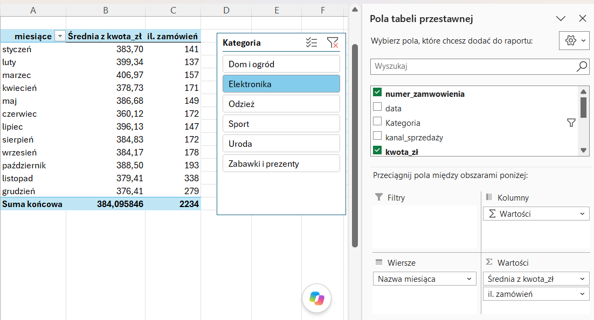<br>
  <em><b>Screenshot 45.</b> Pivot table with a slicer: average order value and number of orders by month (Electronics)</em>
</p>

For this table I chose a combo chart (column-line), because it best shows the relationship between two measures with different units. The number of orders is shown as columns on the left axis, and the average order value as a line on the right, secondary axis. When building the chart I paid attention to two things:

- **Two axes with titles.** Without a secondary axis both measures would be on one scale, and numbers of orders and zloty are not comparable.
- **The right axis starts at zero.** By default Excel set it to start at PLN 330. With such a scale, small fluctuations in the average looked like big jumps.

The chart title does not contain the category name, because the category changes after clicking in the slicer. I describe the analysis using two categories with a different sales rhythm as examples: Electronics (Elektronika) and Clothing (Odzież).

As a reminder, the sales of Electronics in consecutive months look like this:

<p align="center">
  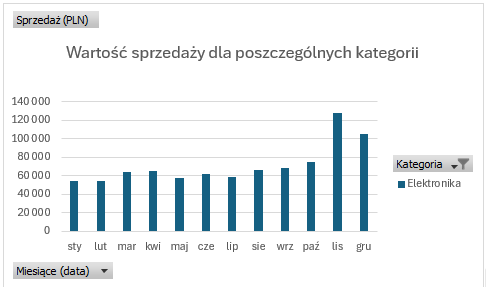<br>
  <em><b>Screenshot 46.</b> Electronics sales in consecutive months („Wartość sprzedaży dla poszczególnych kategorii”)</em>
</p>

<p align="center">
  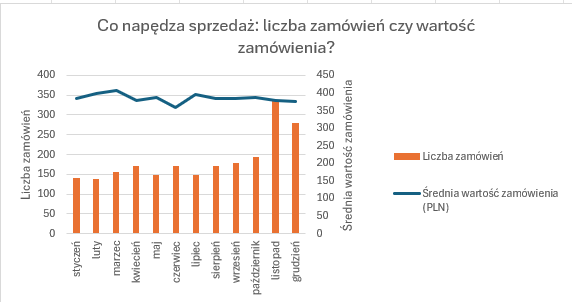<br>
  <em><b>Screenshot 47.</b> Combo chart: number of orders and average order value, Electronics („Co napędza sprzedaż: liczba zamówień czy wartość zamówienia?”)</em>
</p>

The charts above show that the growth in Electronics sales in November and December does not come from a higher order value. The average in November (PLN 379.41) and December (PLN 376.41) is even slightly lower than in October (PLN 388.50) and than the average from January to October (approx. PLN 387). What grows is the number of orders: from about 162 per month in January–October to 338 in November, i.e. more than double. In December, along with the drop in sales, the number of orders also falls (279), and the average order value practically stays the same, which is rather unusual, because we would rather expect November and December to be the period when the average order value is the highest, whereas here the average order value does not grow and even drops slightly. I think it would be good to check whether this trend continues in the future, and if so, to examine whether it is worth taking some actions to encourage customers to buy more expensive equipment (e.g. attractive instalment plans).

I did a similar analysis for Clothing, which has several smaller peaks instead of one big one:

<p align="center">
  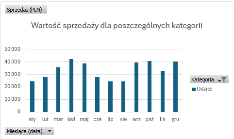<br>
  <em><b>Screenshot 48.</b> Clothing sales in consecutive months („Wartość sprzedaży dla poszczególnych kategorii”)</em>
</p>

Clothing reaches its highest sales in April, followed by September, October and December. July and August are the weakest.

<p align="center">
  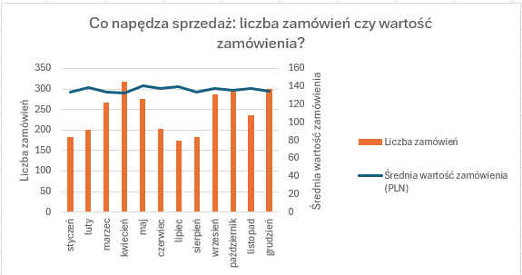<br>
  <em><b>Screenshot 49.</b> Combo chart: number of orders and average order value, Clothing („Co napędza sprzedaż: liczba zamówień czy wartość zamówienia?”)</em>
</p>

The situation is similar to Electronics. The average order value stays at a stable level of PLN 132–140 throughout the year. The number of orders, on the other hand, ranges from 175 in July to 318 in April, and its course looks almost identical to the Clothing sales chart. Once again it is the number of orders that drives sales growth.

The same pattern can be seen after switching the slicer to the other categories: the average order value is stable throughout the year in each of them, while the number of orders changes. This is most visible in the Toys & Gifts category (Zabawki i prezenty), where the number of orders grows from about 70–130 per month to 383 in November and 527 in December, with the average consistently around PLN 70–78.

> Sales growth in peak months comes from a larger number of orders, not from a higher order value. In the season more customers buy, or the same customers buy more often, but their orders are not more expensive.

Since the number of orders grows in the season, it is worth preparing for more traffic: product availability, order handling and logistics in November and December. At the same time, the average order value does not grow even at the peak, which again is rather puzzling, because in December average orders are usually much higher.

### 10.2 Is there an increase in the share of the advertising channels in sales?

I decided to check whether in the advertising channels, such as Facebook Ads and Google Ads, there is an increase in the share of sales during the year that could suggest running advertising campaigns. In section 9.7 it turned out that the channel structure is the same in all categories. This does not mean, however, that it is constant over time. If the company ran advertising campaigns, their effect could be visible as a temporary increase in the share of a given channel.

When preparing the pivot table, I placed the months in Rows, the sales channels in Columns, and the sum of kwota_zł shown as "% of Row Total" ("% sumy wiersza") in Values. Here 100% is the total sales of one month, so each cell shows the channel's share in the sales of a given month. I set one decimal place so as not to lose differences of a few percentage points. I calculate the share by sales value, not by the number of orders, because I am interested in where the revenue comes from. The "Grand Total" row ("Suma końcowa") is the annual channel structure, which serves as a reference point.

<p align="center">
  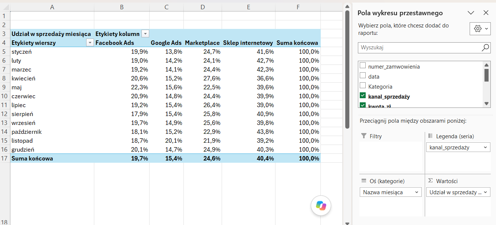<br>
  <em><b>Screenshot 50.</b> Share of sales channels in the sales of each month</em>
</p>

For this table I chose a line chart with a separate line for each channel. When the shares are stable, the lines are almost horizontal, and every deviation is visible as a "hill" or a "dip". On a stacked column chart, changes of a few points would be much harder to notice.

<p align="center">
  <br>
  <em><b>Screenshot 51.</b> Chart: Share of sales channels in consecutive months (share of sales value) („Udział kanałów sprzedaży w kolejnych miesiącach (udział w wartości sprzedaży)”)</em>
</p>

For most of the year the channel shares are stable and differ from the annual structure by 1–2 percentage points. With about 1,000–1,500 orders per month, such differences may be random. Two moments, however, stand out:

- **Google Ads in November.** The channel's share rose to 20.1%, while in the other months it was 13.8–15.6% (15.4% for the year). This is the clearest deviation in the whole table, by almost 5 percentage points. It does not come only from a drop in the other channels: sales through Google Ads in November amounted to about PLN 51k, compared to an average of about PLN 31k per month. In December the share returned to its usual level (14.7%).
- **Facebook Ads in spring.** From April to June the channel's share was slightly higher than usual, with the highest value in May (22.3% compared to the annual level of 19.7%). This deviation is smaller, about 2.6 percentage points, but it lasts for three months in a row.

Smaller movements can also be seen in the other channels: in April the share of Marketplace rose to 27.6%, and the share of the online store (Sklep internetowy) fell to 36.6%. In October the online store reached its highest share of the year (43.8%).

The increase in the share of Google Ads in November and Facebook Ads in spring may suggest that the shop ran advertising campaigns in these channels during these periods. The November increase of Google Ads also coincides with the peak of Electronics sales and the Black Friday period. However, the dataset does not contain any information about marketing activities, so these are only hypotheses.

<p align="right"><a href="#table-of-contents">↑ Back to table of contents</a></p>

---

<a id="s11"></a>
## 11. Dashboard

Finally, I collected all the charts on one sheet. Each chart was created next to its pivot table and then moved to the shared sheet. The charts remain connected to their tables, so after the data is refreshed, the dashboard updates automatically.

The dashboard has one category slicer for the "Sales value by month" chart ("Wartość sprzedaży według miesięcy dla wybranej kategorii"). I gave the charts titles following one pattern ("measure by dimension"), removed unnecessary legends and unified the number format on the axes, so that the whole is consistent and readable without additional explanations.

<p align="center">
  <br>
  <em><b>Screenshot 52.</b> Dashboard: summary of the 2025 sales analysis („Analiza sprzedaży 2025”)</em>
</p>

<p align="right"><a href="#table-of-contents">↑ Back to table of contents</a></p>

---

<a id="s12"></a>
## 12. Analysis summary

Below I have collected the answers to the six questions from section 8 and the results of the additional analyses from section 10.

| Question | Answer |
|---|---|
| Which category sells best? | By value: Electronics (Elektronika, PLN 858,070, 35% of sales). By number of orders: Clothing (Odzież, 2,926) |
| How did sales change over time? | PLN 168–210k per month for most of the year, a clear increase in November (PLN 256k) and December (PLN 272k) |
| What is the share of the sales channels? | Online store (Sklep internetowy) 40.4%, Marketplace 24.6%, Facebook Ads 19.7%, Google Ads 15.4% |
| Highest and lowest average order value? | Highest: Electronics (PLN 384.10). Lowest: Toys & Gifts (Zabawki i prezenty, PLN 74.61). Average for the shop: PLN 172.69 |
| Where are the sales jumps? | Toys & Gifts in December (29% of the year) and November (21%), Electronics in November (15%), Home & Garden (Dom i ogród) from April to July, Sports (Sport) in January |
| Does the channel structure differ between categories? | No. The differences do not exceed 3 percentage points, and the order of the channels is the same everywhere |
| Additionally: what drives sales growth? | The number of orders. The average order value is stable throughout the year, also in peak months |
| Additionally: does the channel share change over time? | Not for most of the year. Exceptions: Google Ads in November (20.1%) and Facebook Ads from April to June (up to 22.3%) |

### Key conclusions

- **A category's revenue is determined by the order value, not by the number of orders.** Electronics has one of the smallest numbers of orders, but thanks to its average of PLN 384 it generates more than one third of sales.
- **Growth over time is determined by the number of orders.** In peak months customers place more orders, but their value does not change.
- **Sales are seasonal, but each category has its own season.** The overall result looks stable, with a jump at the end of the year.
- **The end of the year depends on two categories.** Electronics and Toys & Gifts are responsible for the growth in November and December. In Electronics the growth covers the whole of November, not just the Black Friday day. Toys & Gifts generate about half of their annual sales in two months.
- **The online store is the most important channel.** It accounts for about 40% of sales and 40% of orders, regardless of the category and in every month of the year.
- **The advertising channels may indicate campaigns.** Temporary increases in the share of Google Ads and Facebook Ads are the only clear changes in the channel structure. However, their causes cannot be confirmed with the current data.

### Limitations of the analysis

- The data covers one year, so it is not possible to confirm whether the observed seasonality repeats every year.
- The data contains the order value, without prices and number of products. So it is not possible to determine whether the differences in the average between categories come from more expensive products or from larger baskets.
- The causes of seasonality (Christmas, Black Friday, the gardening season) and of the increases in the share of the advertising channels (campaigns) are hypotheses that the data does not directly confirm.

<p align="right"><a href="#table-of-contents">↑ Back to table of contents</a></p>

---

<a id="s13"></a>
## 13. Business recommendations

Based on the results of the analysis, I formulate several recommendations for the company.

### 13.1 Operational preparation for November and December

November and December are the best months of the year, and sales growth comes from a larger number of orders, not from their higher value (sections 9.5 and 10.1). In Electronics (Elektronika) the number of orders more than doubles in November, and in the Toys & Gifts category (Zabawki i prezenty) it even grows several times.

I think it is worth considering increasing stock in the Electronics and Toys & Gifts categories in advance. In addition, it is worth preparing order handling and shipping for much more traffic than in the rest of the year.

### 13.2 Increasing basket value

The average order value is at a similar level throughout the year, even in peak months (section 10.1). It is lowest in the Beauty (Uroda, PLN 94.63) and Toys & Gifts (PLN 74.61) categories (section 9.3).

I would recommend introducing actions that encourage larger purchases, e.g. product bundles and gift sets, suggestions of complementary products or a free delivery threshold. The Clothing category (Odzież) has particular potential, where a small change in the average order value can bring significant growth, but also e.g. working on the average order value of the Electronics category during the Christmas season, because the number of orders is much higher, while the average order value stays the same, which is very unusual.

### 13.3 Promotions matched to each category's season

The charts show that each category has its own sales rhythm (section 9.6): Toys & Gifts (Zabawki i prezenty) and Electronics (Elektronika) peak at the end of the year, Home & Garden (Dom i ogród) from April to July, Sports (Sport) in January, and Beauty (Uroda) in February, May and December.

It is worth starting to plan promotional activities separately for each category and starting them before its season: Home & Garden in March, Sports at the turn of December and January, Beauty before Valentine's Day and Mother's Day, and Toys & Gifts in October. Thanks to this, promotions support the natural growth in demand, and the categories do not compete with each other for customers' attention at the same time. In addition, as I mentioned earlier, I would try to introduce some actions to increase the average order value in the periods when a given category peaks. For example, as I examined, in the Electronics category there is a peak in orders in November and December, while the average order value stays at a similar level all the time.

<p align="right"><a href="#table-of-contents">↑ Back to table of contents</a></p>

---

<a id="s14"></a>
## 14. Further analysis and data recommendations

### 14.1 What else can be examined with the current data

Even without new data, the dataset allows answering several more questions:

| Analysis | Question it answers |
|---|---|
| Average order value by channel | Do customers from ads spend more or less than customers of the online store and Marketplace? A preliminary calculation from the channel tables indicates a similar level of approx. PLN 169–176, which is worth confirming with a separate table |
| Channels over time by category | Does the November increase of Google Ads concern all categories or mainly Electronics? |
| Sales by day of the week | On which days do customers buy most willingly? |
| Distribution of order values | How many orders are there up to PLN 50, PLN 50–100, PLN 100–200, etc.? Are sales based on many small orders or on a few large ones? |
| Month-over-month dynamics | By what percentage did sales grow or fall compared to the previous month? |

### 14.2 Recommendations for extending the data

The data is of very good quality: it is complete, without duplicates, with valid dates and consistent naming. Its limitation is not quality but scope. A few additional pieces of information would make it possible to answer questions that remained hypotheses in this analysis:

| Additional data | What it would allow to check |
|---|---|
| Marketing campaigns: dates, channel, budget, cost | Whether the increases in the share of Google Ads and Facebook Ads came from campaigns, how much sales they brought and whether they paid off (return on advertising spend) |
| Order items: product, quantity, unit price | Whether the high average in Electronics comes from more expensive products or larger baskets; which products sell best |
| Anonymous customer identifier | How many customers are new and how many are returning; how often customers come back; whether new customers arrive in the season or the same ones buy more often |
| Discounts and promotions assigned to the order | Whether promotions increase the number of orders or their value; what part of sales comes from discounts |
| Product cost or margin | Which categories and channels are the most profitable, not just which bring the most revenue |
| Time the order was placed | At what time of day customers buy most often, e.g. for better campaign planning |
| Customer region or city | Whether sales and the channel structure differ by region |
| Data from subsequent years | Whether seasonality repeats every year and whether the company grows year on year |

<p align="right"><a href="#table-of-contents">↑ Back to table of contents</a></p>
